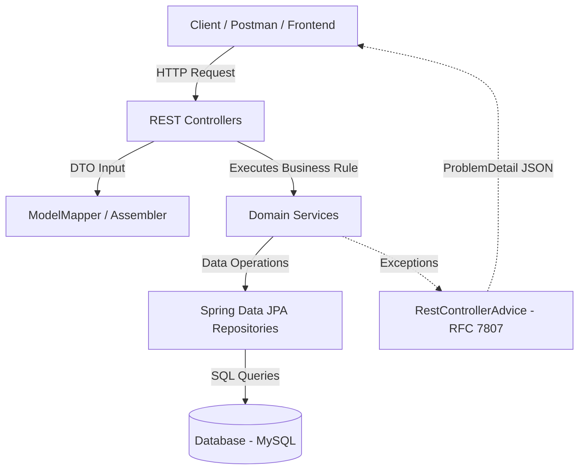
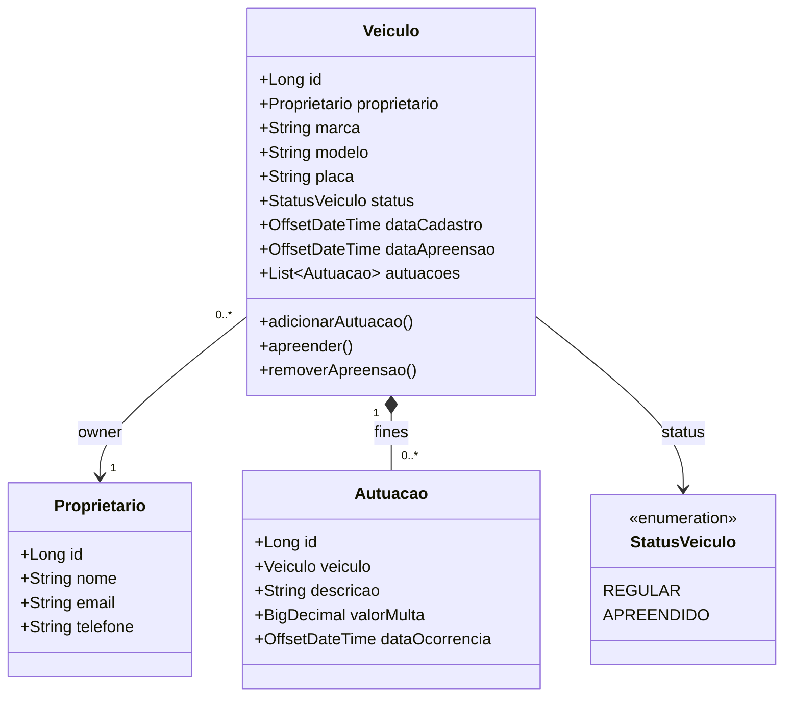

<div align="center">

[](./README.md)
[](./README.en.md)
[](./README.es.md)

[](../../releases/tag/v1.0.0)


</div>

# 🚘 AlgaTrânsito API — Traffic Infraction and Vehicle Management System

This repository contains **AlgaTrânsito API**, a REST API developed for managing vehicles, owners, and traffic
citations, designed to consolidate essential fundamentals of the **Spring** ecosystem, professional RESTful API design,
and software engineering best practices.

The project was developed during the **Ignição Spring REST** training by **AlgaWorks**, combining essential theoretical
foundations with immediate hands-on code implementation, focusing on building a secure, testable, and decoupled
enterprise application step by step.

---

## 🎯 About the System and Key Concepts

**AlgaTrânsito** addresses the challenges of traffic authorities by managing owner registrations, vehicle records,
issuance of traffic fines, and operational status control (such as vehicle impoundment/seizure).

The application covers and implements:

* **REST Modeling & HTTP Best Practices:**
    * Semantic URI naming, proper HTTP verbs (GET, POST, PUT, DELETE), adequate status codes, and *Content Negotiation*
      support.
    * Standardized date/time representation in ISO 8601 format (`OffsetDateTime`).
    * Sub-resource modeling (e.g., `/veiculos/{id}/autuacoes`) and non-CRUD actions (e.g., vehicle impoundment and
      release).
* **Persistence Layer & Migrations:**
    * Object-Relational Mapping (ORM) with **Jakarta Persistence (JPA)** and **Spring Data JPA**.
    * Automated and versioned database schema evolution using **Flyway Migration**.
* **Data Validation & Error Handling:**
    * Declarative and cascading data validation on request inputs using **Jakarta Bean Validation**.
    * Global and standardized exception handling with `@RestControllerAdvice` and support for the **RFC 7807 (Problem
      Details for HTTP APIs)** specification.
* **Decoupling & DTOs (Representation Models):**
    * Isolation between the domain model (*Domain Model*) and representation model (*Representation Model / DTOs*) for
      data input and output.
    * Transparent object mapping and transformation using **ModelMapper** and dedicated assemblers (*Assemblers*).

---

## 📁 Project Structure

```text
aw-transito-api/
├── backend/                  # Source code of the Java / Spring Boot application (AlgaTrânsito)
├── .gitignore                # Git ignore rules (Java, IDEs, Maven, Node)
├── LICENSE                   # Repository License (MIT)
├── README.md                 # Main Documentation (Portuguese)
├── README.en.md              # Documentation (English)
└── README.es.md              # Documentation (Spanish)
```

---

## 🏛️ Solution Architecture



### 📐 Domain Class Diagram (UML)



### 🧩 Ecosystem Components

* **`REST Controllers`:** Controllers responsible for exposing API endpoints, initial request validation, and request
  routing.
* **`Domain Services`:** Service layer containing pure business rules of the traffic domain (e.g., duplicate email
  check, vehicle impoundment).
* **`Spring Data JPA Repositories`:** Smart repositories for full abstraction of SQL commands and refined queries (
  *Query Methods*).
* **`Flyway Migration`:** Tool responsible for executing versioned SQL scripts to keep the database schema in sync.
* **`ModelMapper & Assemblers`:** Components in charge of converting domain entities into representation DTOs and
  vice-versa.

---

## 🛠️ Technologies and Tools

* **Language & Framework:** Java 17+, Spring Boot 3+, Spring MVC
* **Persistence & Migration:** Jakarta Persistence (JPA), Spring Data JPA, Flyway Migration, MySQL
* **Validation & Productivity:** Jakarta Bean Validation, Project Lombok, Spring Boot DevTools
* **Mapping & DTOs:** ModelMapper
* **Standardization & Error Handling:** RFC 7807 (Problem Details), ISO 8601 (`OffsetDateTime`)

<br />

<div align="center">

    
    
 

</div>

---

## 📌 Next Steps (Roadmap)

> 💡 **Scope note:** Version **v1.0.0** consolidates the full baseline of the **Ignição Spring REST** training by
> AlgaWorks. Versions from **v2.0.0** onwards represent **authorial expansions and extra practice**, implemented
> independently to elevate project maturity with automated testing, a graphical interface, interactive documentation,
> and
> security.

| Version                                                                                                                | Description                                                                                                                           |
|:-----------------------------------------------------------------------------------------------------------------------|:--------------------------------------------------------------------------------------------------------------------------------------|
| [](../../releases/tag/v1.0.0) | **[AlgaWorks Baseline]** Delivery of the core ecosystem: CRUDs, Flyway, Bean Validation, ModelMapper, RFC 7807, and non-CRUD actions. |
| [](../../releases/tag/v2.0.0)         | **[Extra Practice]** Automated test suite (unit and integration) with JUnit 5, Mockito, and REST Assured.                             |
| [](../../releases/tag/v3.0.0)         | **[Extra Practice]** Web interface (Front-end Dashboard) for visual management and tracking of vehicles and citations.                |
| [](../../releases/tag/v4.0.0)         | **[Extra Practice]** Interactive API route documentation using OpenAPI 3 / Swagger UI.                                                |
| [](../../releases/tag/v5.0.0)         | **[Extra Practice]** Security layer, access control, and authentication with Spring Security and OAuth2 / JWT.                        |

---

## 🍃 About

Theory and practical project developed during the **Ignição Spring REST** course on the 🍃 **AlgaWorks** platform.

---

## 👤 Author

Developed by **Ivan Ferreira**.

Copyright © 2026 Ivan Ferreira. All rights reserved.

---

<div align="center">

[](./README.md)

</div>