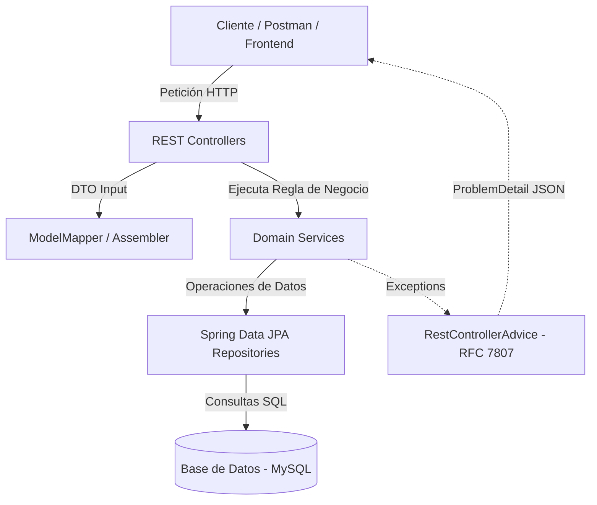
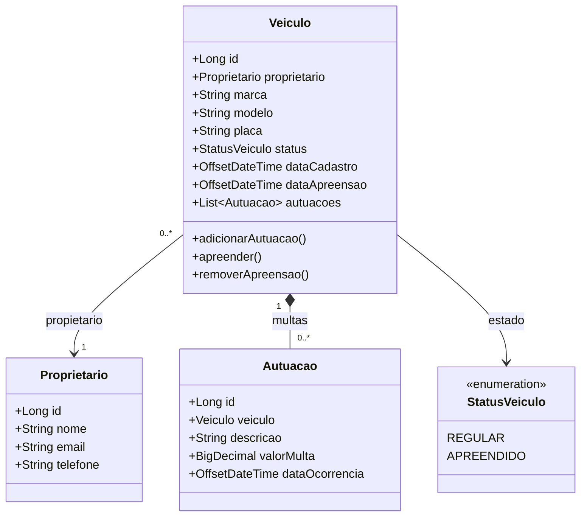

<div align="center">

[](./README.md)
[](./README.en.md)
[](./README.es.md)

[](../../releases/tag/v1.0.0)


</div>

# 🚘 AlgaTrânsito API — Sistema de Gestión de Vehículos e Infracciones de Tránsito

Este repositorio contiene la **AlgaTrânsito API**, una REST API desarrollada para la gestión de vehículos, propietarios
y multas de tránsito, diseñada para consolidar los fundamentos esenciales del ecosistema **Spring**, modelado de APIs
RESTful profesionales y buenas prácticas de ingeniería de software.

El proyecto fue desarrollado durante la capacitación **Ignição Spring REST** de **AlgaWorks**, alineando la base teórica
esencial con la implementación práctica inmediata en código, enfocándose en la construcción gradual de una aplicación
empresarial segura, testeable y desacoplada.

---

## 🎯 Sobre el Sistema y Conceptos Clave

**AlgaTrânsito** resuelve los desafíos del dominio de organismos de tránsito, gestionando el registro de propietarios,
inscripción de vehículos, aplicación de multas y control del estado operativo (como retención/embargo de vehículos).

La aplicación aborda e implementa:

* **Modelado REST y Buenas Prácticas HTTP:**
    * Nombramiento semántico de URIs, uso correcto de verbos HTTP (GET, POST, PUT, DELETE), códigos de estado adecuados
      y soporte para *Content Negotiation*.
    * Estandarización de fechas/horas en formato ISO 8601 (`OffsetDateTime`).
    * Modelado de subrecursos (ej: `/veiculos/{id}/autuacoes`) y acciones no-CRUD (ej: retención y liberación de
      vehículos).
* **Capa de Persistencia y Migraciones:**
    * Mapeo objeto-relacional (ORM) con **Jakarta Persistence (JPA)** y **Spring Data JPA**.
    * Evolución automatizada y versionada del esquema de base de datos mediante **Flyway Migration**.
* **Validación de Datos y Manejo de Errores:**
    * Validaciones declarativas y en cascada en la entrada de datos con **Jakarta Bean Validation**.
    * Manejo global y estandarizado de excepciones con `@RestControllerAdvice` y soporte para la especificación **RFC
      7807 (Problem Details for HTTP APIs)**.
* **Desacoplamiento y DTOs (Representation Models):**
    * Aislamiento entre el modelo de dominio (*Domain Model*) y el modelo de representación (*Representation Model /
      DTOs*) para entrada y salida de datos.
    * Mapeo y transformación transparente de objetos utilizando **ModelMapper** y ensambladores dedicados (
      *Assemblers*).

---

## 📁 Estructura del Proyecto

```text
aw-transito-api/
├── backend/                  # Código fuente de la aplicación Java / Spring Boot (AlgaTrânsito)
├── .gitignore                # Reglas de ignorados de Git (Java, IDEs, Maven, Node)
├── LICENSE                   # Licencia del repositorio (MIT)
├── README.md                 # Documentación principal (Portugués)
├── README.en.md              # Documentation (Inglés)
└── README.es.md              # Documentación (Español)
```

---

## 🏛️ Arquitectura de la Solución



### 📐 Diagrama de Clases del Dominio (UML)



### 🧩 Componentes del Ecosistema

* **`REST Controllers`:** Controladores responsables de exponer los endpoints de la API, validación inicial y
  enrutamiento de peticiones.
* **`Domain Services`:** Capa de servicio donde residen las reglas de negocio puras del dominio de tránsito (ej:
  verificación de correo duplicado, retención de vehículos).
* **`Spring Data JPA Repositories`:** Repositorios inteligentes para abstracción total de comandos SQL y consultas
  refinadas (*Query Methods*).
* **`Flyway Migration`:** Herramienta responsable de ejecutar scripts SQL versionados para mantener la base de datos
  sincronizada.
* **`ModelMapper & Assemblers`:** Componentes encargados de convertir entidades de dominio en DTOs de representación y
  viceversa.

---

## 🛠️ Tecnologías y Herramientas

- **Lenguaje y Framework:** Java 17+, Spring Boot 3+, Spring MVC
- **Construcción y Dependencias:** Apache Maven
- **Persistencia y Migración:** Jakarta Persistence (JPA), Spring Data JPA, Flyway Migration, MySQL
- **Validación y Productividad:** Jakarta Bean Validation, Project Lombok, Spring Boot DevTools
- **Mapeo y DTOs:** ModelMapper
- **Estandarización y Manejo de Errores:** RFC 7807 (Problem Details), ISO 8601 (`OffsetDateTime`)
- **Pruebas y Documentación de API:** Postman

<br />

<div align="center">

     
     
 

</div>

---

## 📌 Próximos Pasos (Hoja de Ruta)

> 💡 **Nota sobre el alcance:** La versión **v1.0.0** consolida la línea base (*baseline*) completa de la capacitación *
*Ignição Spring REST** de AlgaWorks. Las versiones a partir de la **v2.0.0** representan **expansiones autorales y
prácticas extras**, implementadas por iniciativa propia para elevar la madurez del proyecto con pruebas automatizadas,
> interfaz gráfica, documentación interactiva y seguridad.

| Versión                                                                                                                                                                           | Descripción                                                                                                                          |
|:----------------------------------------------------------------------------------------------------------------------------------------------------------------------------------|:-------------------------------------------------------------------------------------------------------------------------------------|
| [](https://github.com/ivanfsilva/aw-transito-api/releases/tag/v1.0.0) | **[Baseline AlgaWorks]** Entrega del ecosistema principal: CRUDs, Flyway, Bean Validation, ModelMapper, RFC 7807 y acciones no-CRUD. |
| [](../../releases/tag/v2.0.0)                                                                    | **[Práctica Extra]** Suite de pruebas automatizadas (unitarias y de integración) con JUnit 5, Mockito y REST Assured.                |
| [](../../releases/tag/v3.0.0)                                                                    | **[Práctica Extra]** Interfaz web (Dashboard Front-end) para la gestión y seguimiento visual de vehículos y multas.                  |
| [](../../releases/tag/v4.0.0)                                                                    | **[Práctica Extra]** Documentación interactiva de rutas de la API utilizando OpenAPI 3 / Swagger UI.                                 |
| [](../../releases/tag/v5.0.0)                                                                    | **[Práctica Extra]** Capa de seguridad, control de acceso y autenticación con Spring Security y OAuth2 / JWT.                        |

---

## 🍃 Sobre

Teoría y proyecto práctico desarrollado durante el curso **Ignição Spring REST** de la plataforma 🍃 **AlgaWorks**.

---

## 👤 Autor

Desarrollado por **Ivan Ferreira**.

Copyright © 2026 Ivan Ferreira. Todos los derechos reservados.

---

<div align="center">

[](./README.md)

</div>