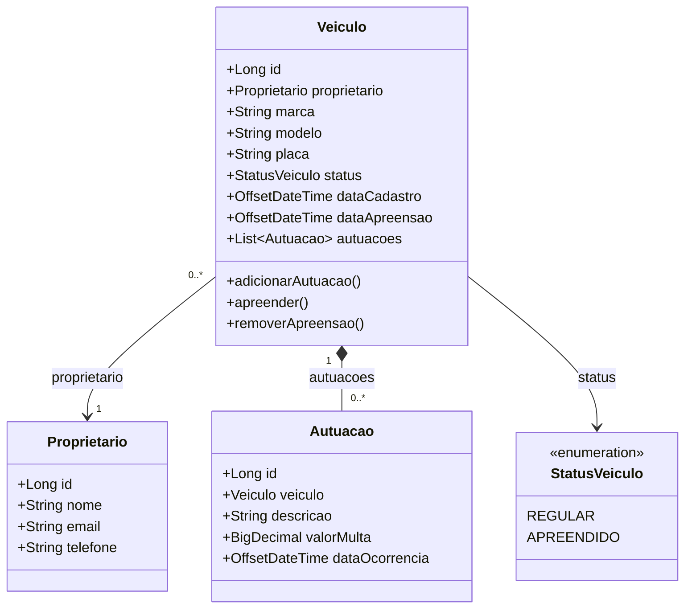

<div align="center">

[](./README.md)
[](./README.en.md)
[](./README.es.md)

[](../../releases/tag/v1.0.0)


</div>

# 🚘 AlgaTrânsito API — Sistema de Gestão de Veículos e Infração de Trânsito

Este repositório contém a **AlgaTrânsito API**, uma REST API desenvolvida para a gestão de veículos, proprietários e
autuações de trânsito, projetada para consolidar os fundamentos essenciais do ecossistema **Spring**, modelagem de APIs
RESTful profissionais e boas práticas de engenharia de software.

O projeto foi desenvolvido ao longo do treinamento **Ignição Spring REST** da **AlgaWorks**, que alinha o embasamento
teórico essencial à implementação prática imediata no código, focando na construção gradual de uma aplicação corporativa
segura, testável e desacoplada.

---

## 🎯 Sobre o Sistema e Conceitos-Chave

O **AlgaTrânsito** resolve os desafios do domínio de órgãos de trânsito, gerenciando o cadastro de proprietários,
registro de veículos, aplicação de autuações e controle do status operacional (como retenção/apreensão de veículos).

A aplicação aborda e implementa:

* **Modelagem REST e Boas Práticas HTTP:**
    * Nomeação semântica de URIs, uso correto dos verbos HTTP (GET, POST, PUT, DELETE), códigos de status adequados e
      suporte a *Content Negotiation*.
    * Padronização de datas/horas no formato ISO 8601 (`OffsetDateTime`).
    * Modelagem de sub-recursos (ex: `/veiculos/{id}/autuacoes`) e ações não-CRUD (ex: apreensão e liberação de
      veículos).
* **Camada de Persistência e Migrações:**
    * Mapeamento objeto-relacional (ORM) com **Jakarta Persistence (JPA)** e **Spring Data JPA**.
    * Evolução automatizada e versionada do schema do banco de dados utilizando **Flyway Migration**.
* **Validação de Dados e Tratamento de Erros:**
    * Validações declarativas e em cascata na entrada de dados com **Jakarta Bean Validation**.
    * Tratamento global e padronizado de exceções com `@RestControllerAdvice` e suporte à especificação **RFC 7807 (
      Problem Details for HTTP APIs)**.
* **Desacoplamento e DTOs (Representation Models):**
    * Isolamento entre o modelo de domínio (*Domain Model*) e o modelo de representação (*Representation Model / DTOs*)
      para entrada e saída de dados.
    * Mapeamento e transformação transparente de objetos utilizando **ModelMapper** e montadores dedicados (
      *Assemblers*).

---

## 📁 Estrutura do Projeto

```text
aw-transito-api/
├── backend/                  # Código-fonte da aplicação Java / Spring Boot (AlgaTrânsito)
├── .gitignore                # Regras de ignorados do Git (Java, IDEs, Maven, Node)
├── LICENSE                   # Licença do repositório (MIT)
├── README.md                 # Documentação principal (Português)
├── README.en.md              # Documentation (English)
└── README.es.md              # Documentación (Español)
```

---

## 🏛️ Arquitetura da Solução

```mermaid
graph TD
    Client[Cliente / Postman / Frontend] -->|Requisição HTTP| Controller[REST Controllers]
    Controller -->|DTO Input| Assembler[ModelMapper / Assembler]
    Controller -->|Executa Regra| Service[Domain Services]
    Service -->|Operações de Dados| Repository[Spring Data JPA Repositories]
    Repository -->|SQL Queries| DB[(Banco de Dados - MySQL)]
    
    Service -.->|Exceptions| ExceptionHandler[RestControllerAdvice - RFC 7807]
    ExceptionHandler -.->|ProblemDetail JSON| Client
```



### 📐 Diagrama de Classes do Domínio (UML)



### 🧩 Componentes do Ecossistema

* **`REST Controllers`:** Controladores responsáveis pela exposição dos endpoints da API, validação inicial e
  direcionamento de chamadas.
* **`Domain Services`:** Camada de serviço onde residem as regras de negócio puras do domínio de trânsito (ex:
  verificação de e-mail duplicado, apreensão de veículos).
* **`Spring Data JPA Repositories`:** Repositórios inteligentes para abstração total de comandos SQL e consultas
  refinadas (*Query Methods*).
* **`Flyway Migration`:** Ferramenta responsável por executar scripts SQL versionados para manter o banco de dados
  sincronizado.
* **`ModelMapper & Assemblers`:** Componentes encarregados de converter entidades de domínio em DTOs de representação e
  vice-versa.

---

## 🛠️ Tecnologias e Ferramentas

- **Linguagem & Framework:** Java 17+, Spring Boot 3+, Spring MVC
- **Build & Dependências:** Apache Maven
- **Persistência & Migração:** Jakarta Persistence (JPA), Spring Data JPA, Flyway Migration, MySQL
- **Validação & Produtividade:** Jakarta Bean Validation, Project Lombok, Spring Boot DevTools
- **Mapeamento & DTOs:** ModelMapper
- **Padronização & Tratamento de Erros:** RFC 7807 (Problem Details), ISO 8601 (`OffsetDateTime`)
- **Testes & Documentação de API:** Postman

<br />

<div align="center">

 
    
     
 

</div>

---

## 📌 Próximos Passos (Roadmap)

> 💡 **Nota sobre o escopo:** A versão **v1.0.0** consolida o *baseline* completo do treinamento **Ignição Spring REST**
> da AlgaWorks. As versões a partir da **v2.0.0** representam **expansões autorais e práticas extras**, implementadas
> por
> iniciativa própria para elevar a maturidade do projeto com testes automatizados, interface gráfica, documentação
> interativa e segurança.

| Versão                                                                                                                                                                                 | Descrição                                                                                                                          |
|:---------------------------------------------------------------------------------------------------------------------------------------------------------------------------------------|:-----------------------------------------------------------------------------------------------------------------------------------|
| [](https://github.com/ivanfsilva/aw-transito-api/releases/tag/v1.0.0) | **[Baseline AlgaWorks]** Entrega do ecossistema principal: CRUDs, Flyway, Bean Validation, ModelMapper, RFC 7807 e ações não-CRUD. |
| [](../../releases/tag/v2.0.0)                                                                         | **[Prática Extra]** Suíte de testes automatizados (unitários e de integração) com JUnit 5, Mockito e REST Assured.                 |
| [](../../releases/tag/v3.0.0)                                                                         | **[Prática Extra]** Interface web (Dashboard Front-end) para gestão e acompanhamento visual de veículos e autuações.               |
| [](../../releases/tag/v4.0.0)                                                                         | **[Prática Extra]** Documentação interativa das rotas da API utilizando OpenAPI 3 / Swagger UI.                                    |
| [](../../releases/tag/v5.0.0)                                                                         | **[Prática Extra]** Adição de camada de segurança, controle de acesso e autenticação com Spring Security e OAuth2 / JWT.           |

---


## 🍃 Sobre

Teoria e projeto prático desenvolvido durante o curso **Ignição Spring REST** da plataforma 🍃 **AlgaWorks**.

---

## 👤 Autor

Desenvolvido por **Ivan Ferreira**.

Copyright © 2026 Ivan Ferreira. Todos os direitos reservados.